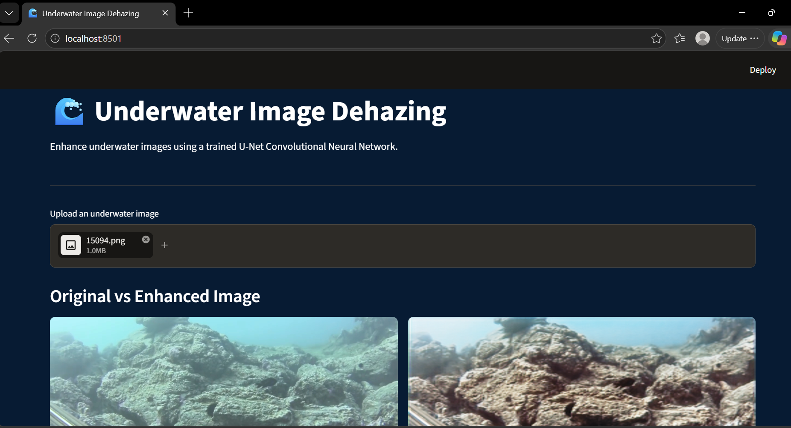

\# Underwater Image Dehazing Using U-Net CNN


\## Project Overview

This project uses a U-Net Convolutional Neural Network (CNN) to enhance underwater images by reducing haze and improving image clarity, brightness, and color.


\## Dataset

\- UIEB (Underwater Image Enhancement Benchmark)

\- Contains underwater images and their corresponding reference enhanced images.


\## Model Architecture

\- U-Net CNN

\- Encoder-decoder architecture

\- Skip connections

\- Input image size: 256 × 256

\- Output: Enhanced underwater image


\## Technologies Used

\- Python

\- TensorFlow / Keras

\- NumPy

\- Matplotlib

\- Streamlit

\- Pillow


\## Project Files

\- `app.py` – Streamlit application

\- `notebooks/` – Model training notebook

\- `requirements.txt` – Required Python libraries

\- `best\_uieb\_unet.keras` – Trained model (kept separately from GitHub)


\## Run the Application


Install dependencies:


```bash

pip install -r requirements.txt

```


Run Streamlit:


```bash

streamlit run app.py

```
## Project Output

### Original vs Enhanced Underwater Image




\## Output

The application accepts an underwater image and displays its enhanced version.


